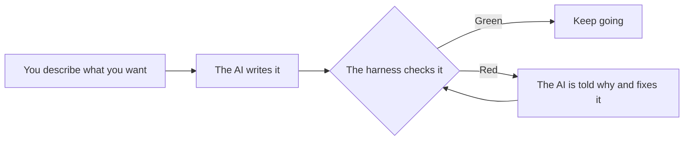

# Agent Harness

Scripts and hooks you copy into a repo so the rules you give a coding agent are checked by code,
not left to the agent's memory.

An agent follows a written rule until it doesn't, and nothing tells you when it stopped. Here,
every rule that matters is a check that fails loudly with an exit code. Anything that is still
just a written rule is labelled as one.

Node 20 or newer, built-ins only, zero dependencies. This repo is checked by the harness it ships.

## Not a developer? Start here

You do not need to read code to use this. You tell an AI what to build, and the harness checks
the AI's work for you.



**What the colours mean**

| Result | In plain words |
|---|---|
| 🟢 Green | Every check the project has was run, and none failed or went missing. |
| 🔴 Red | A check failed or disappeared. Nothing is broken for good: the AI is told exactly what to fix. |
| ⚪ Skipped | A check did not run. It proved nothing, so ask why before you rely on the result. |

**Your first hour**

1. Open your project in Claude Code, the AI coding tool this guide is built for.
2. Ask it to copy this harness into your project. It shows you the list of files first.
3. Ask it to check that every piece is in place.
4. Type `/guide`. It walks you through the rest in plain English, one step at a time.

> **What green does not mean.** Green does not mean the idea is good, that customers want it, or
> that the product is secure. It means the checks your project has all ran and passed. A project
> with few checks goes green easily.

Everything below this line is written for developers.

## Why this is different

Most agent harness repos give you prompts, agent definitions or an orchestration framework. This
one gives you none of those as its main product. It gives you the checks around them:

- **A missing check is a failure.** Each gate's total is compared with a committed baseline, so a
  test that was deleted or silently skipped turns the run red.
- **Bad actions are blocked before they run**, by hooks, not asked for politely in a prompt.
- **"Done" is a script.** A phase closes only when the script sees current evidence.
- **It says what it cannot do.** See [What it does not do](#what-it-does-not-do).
- **Nothing to install.** No dependencies, no build, no service, no model calls.

## Who it is for

- You run a coding agent on a real repo, across many sessions.
- You have seen an agent skip a rule, quote a stale test count or call unfinished work done.
- You want that caught by CI and hooks instead of by review.
- You are not a tech expert and you drive a coding agent yourself: [start here](#not-a-developer-start-here).

## Who it is not for

- You want a framework for building or orchestrating agents. This calls no model.
- You want a prompt or skill library to drop in.
- You cannot run Node 20 on your machine and in CI.
- You want blocking hooks on a tool other than Claude Code today (see [Your stack](#your-stack)).

## When to use it

Use it once the same rule has been broken silently more than once, or when work spans sessions
and each new session re-learns what the last one knew. For a one-off script or a weekend
prototype it is more process than you need.

## Install

There is no published package. Installing is copying. You need Node >= 20, git and a POSIX shell
(on Windows, the one Git provides).

```bash
git clone <this-repository> agent-harness

node agent-harness/bin/harness.js init --into <your-repo> --dry-run   # the plan; writes nothing
node agent-harness/bin/harness.js init --into <your-repo>
```

`init` never overwrites a file without `--force`, and it copies no numbers measured on another
repo: your baseline starts empty. It writes no `.gitattributes`; pin your line endings yourself.

To try it here first:

```bash
node bin/harness.js selftest    # every --self-test in the repo
npm test                        # node --test
npm run gates                   # every gate against the committed baseline
node bin/harness.js doctor      # every piece: OK / MISSING / DRIFTED, each with its fix
```

On a fresh clone or a CI runner the `docs` gate reports one skip and says why. An undeclared skip
is red on purpose, so allow it by name:

```bash
node scripts/harness/gates.js --check --allow-skip reproducible-build=1,docs=1
```

## Quickstart

1. **Init**, as above. It detects your package manager, test command, docs folder and default
   branch, and lists the placeholders it left for you to fill in `AGENTS.md`.
2. **Read `harness.config.json`.** It is the only place the harness learns about your project.
   Add your own checks to its `gates` array. With no config file, every script stops; there is
   no default suite.
3. **Run the gates.** `git add` first, because the context gate reads tracked files only.

   ```
   $ node scripts/harness/gates.js --check --allow-skip reproducible-build=1
   GATES RED — 1 violation(s) against scripts\harness\gates.baseline.json:
     x docs: skipped=1 and no --allow-skip docs=n was given
   ```

   The first run is red, and should be. Read the reason, allow the skip, record the baseline:

   ```
   $ node scripts/harness/gates.js --accept --allow-skip reproducible-build=1,docs=1
   $ node scripts/harness/gates.js --check  --allow-skip reproducible-build=1,docs=1
   GATES GREEN — test 1/1 . docs 147/148 (1 skipped, declared) . context 6/6 . hygiene 7/7 . skills 2/2 . reproducible-build 0/1 (1 skipped, declared)
   ```

4. **Commit** (a commit that changes the baseline needs a subject starting `gates:`), run
   `node agent-harness/bin/harness.js doctor`, and put the same `--check` command in CI.

What the baseline buys you: delete a test later and nothing fails, yet the run is red.

```
GATES RED — 2 violation(s) against scripts\harness\gates.baseline.json:
  x test: pass 1 < baseline 2
  x test: 1 checks in the total, baseline had 2 — a check DISAPPEARED (pass-by-absence)
```

Full walk-through, including how to confirm the hooks fire:
[docs/methods/11-adopting-this-in-your-repo.md](docs/methods/11-adopting-this-in-your-repo.md).

## What you get

| Piece | What it stops | Where |
|---|---|---|
| Gates and a baseline | Stale totals in docs; a check that vanished while the suite stayed green | `scripts/harness/gates.js` |
| Reproducible-build check | A source edit committed without its rebuilt bundle | `scripts/harness/gates.js` |
| Secret-file guard | A credential file read into a transcript | `scripts/harness/guards/env-guard.cjs` |
| Phase guard | A status flipped by hand; a gate figure typed into a doc | `scripts/harness/guards/phase-guard.cjs` |
| Commit hygiene | Stray files, pasted tokens and root clutter in a commit | `scripts/harness/guards/commit-hygiene.cjs` |
| Doc contract | Docs over their line cap; an index that drifted from the docs | `scripts/harness/guards/docs-lint.cjs` |
| Context budget | Always-loaded instruction files growing unnoticed | `scripts/harness/measure-context.js` |
| Tracks and handoffs | A new session re-deriving what the last one knew | `templates/track/` |
| Phase lifecycle | A phase closed on evidence from a different tree | `scripts/harness/close-phase.js` |
| Skill lock | A third-party skill changing with no diff anyone read | `scripts/harness/guards/skill-verify.cjs` |
| Branch sync | A long-lived branch running an old copy of the harness | `scripts/harness/branch-sync.js` |
| Installer and doctor | An install nobody verified | `bin/harness.js` |

Each piece has a page under [docs/methods/](docs/methods/README.md): the failure, the mechanism,
its cost and its limits.

## Your stack

- **The harness is Node.** Your project need not be, but Node >= 20 must be on the machine and in CI.
- **Any language can be gated.** A gate is any shell command. If its last stdout line is
  `GATE <name> pass=<n> fail=<n> skipped=<n>` the counts are read exactly; otherwise the
  `exit-code` adapter grades it as one pass or one fail. `init` detects Node, Go, Rust and Python
  test commands.
- **The blocking hooks are wired for Claude Code.** So are the agent and skill files and the
  status line. Support for other tools is in progress and not finished.
- **The policy is not tied to one tool.** It lives in `AGENTS.md`, which most coding agents load;
  `CLAUDE.md` is a one-line pointer to it.
- **What works anywhere today:** `gates.js --check` in CI, and `commit-hygiene.cjs --report` in a
  git pre-commit hook or a CI step.

## What it does not do

- **A green gate does not prove the code is correct.** It proves the declared checks ran, none
  failed and none vanished.
- **Nobody has measured that it improves output.** There is no run with the harness off to
  compare against.
- **The guards match patterns.** A different spelling of the same action can get through. They
  stop accidents, not a determined agent or an attacker.
- **The skill lock cannot cover what lives outside the repo:** plugin caches, user-level skills
  and MCP servers. It reports them as uncovered; it does not secure them.
- **The context budget counts bytes of the files you declare.** Tool schemas and the system
  prompt are usually larger and are not counted.
- **The lints check shape, not quality.** An unfilled handoff template passes.
- **It is not an agent framework.** It orchestrates nothing and calls no model.

## Repo layout

```
bin/                     harness.js: the installer and CLI (init, doctor, gates, docs, host, selftest)
scripts/harness/         the gate runner, config loader, lifecycle and doc scripts, baselines
scripts/harness/guards/  the guards, the doc linter, the skill verifier
.claude/                 hook wiring, four agent briefs, four skills, the status line
schema/                  the JSON schema for harness.config.json
templates/               starting files for AGENTS.md, CLAUDE.md, the routing doc and a track
docs/methods/            one page per mechanism
docs/reference/          the enforced shapes: doc standard, routing, skill safety, branches
docs/tracks/             open work on this repo
tests/                   node:test; every script run as a real process in a throwaway repo
.github/                 the CI workflow, Dependabot and scanner configs
```

`harness.config.json` holds everything project-specific. `AGENTS.md` is this repo's own policy
and the starting point for yours.

## Contributing

See [CONTRIBUTING.md](CONTRIBUTING.md). Changes are listed in [CHANGELOG.md](CHANGELOG.md).

## Licence

MIT. See [LICENSE](LICENSE).
